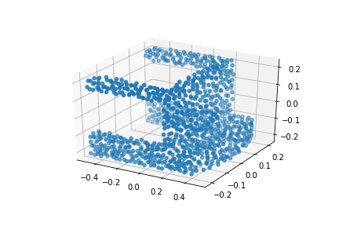
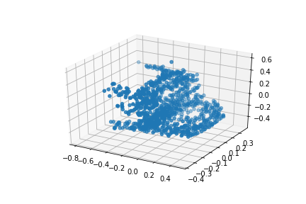

# Shape-Generation-using-Spatially-Partitioned-Point-Clouds

An implementation of [*Shape Generation using Spatially Partitioned Point Clouds*](https://arxiv.org/abs/1707.06267) (Gadelha, Maji and Wang, BMVC 2017), which generates 3D chairs as point clouds.

## How it works

A point cloud is an unordered set of points, so the same chair can be listed in many orders. The paper first puts every shape's points into a *consistent* order, so the shapes can be compressed with PCA. A GAN then learns to generate the compressed form.

The notebook, [`KDTree.ipynb`](KDTree.ipynb), runs this in three parts.

### 1. KD-tree sorting
Each chair (1,000 points) is split at its median point along x, then along y for each half, then z, and so on. The points are then listed in tree order, so the same position in the list falls in roughly the same region of every chair. A quickselect-based median search does each split in linear time.

### 2. Reordering points to reduce PCA reconstruction error
All shapes become rows of a matrix, with each shape's points flattened as `x0, y0, z0, x1, …`. The code fits PCA with 100 components, then repeatedly swaps random pairs of points within a shape. A swap is kept only if it lowers that shape's **current** reconstruction error, so the error never increases. PCA is refitted as the shapes change.

Two versions are included:
- **Per shape:** 10,000 swap attempts per shape, refitting PCA after each shape. This is slow, but follows the paper closely.
- **All shapes at once (faster):** each round proposes one swap for every shape at the same time. PCA is refitted every `swap_rounds` rounds (default 40), for `n_iters` refits (default 1,000).

Progress (per-shape errors and the reordered shapes) is saved to Google Drive as `errlist.npy` / `Pu.npy` (per-shape version) or `vec_errlist1.npy` / `vec_Pu1.npy` (all-at-once version).

### 3. Wasserstein GAN on PCA coefficients
After reordering, each shape is described by its 100 PCA coefficients, recomputed from the reordered shapes. Each coefficient is scaled to unit variance. A fully connected **Wasserstein GAN with weight clipping** ([Arjovsky et al., 2017](https://arxiv.org/abs/1701.07875)) learns to generate these vectors:

| Network | Layers |
|---|---|
| Generator | noise (100, uniform in [−1, 1]) → 4 × [Dense 100 → BatchNorm → ReLU] → Dense 100 |
| Discriminator | coefficients (100) → 4 × [Dense 100 → LeakyReLU 0.2] → Dense 1. Weights clipped to ±0.01, no BatchNorm |

| Setting | Value |
|---|---|
| Optimizer | RMSprop, learning rate 5 × 10⁻⁵ (both networks) |
| Discriminator updates per generator update | 5 (`n_critic`) |
| Batch size | 64 |
| Epochs | 500 (a starting point; Wasserstein GANs train slowly) |
| Moment-matching term | Optional, off by default (`mm_weight = 0.0`) |

To make a new chair, the generated coefficients are scaled back, multiplied by the PCA basis, and the mean shape is added back. Basis and mean are the same ones the GAN was trained on.

## Running it

The notebook is written for Google Colab and reads data from Google Drive.

1. **Data:** put the ShapeNet chair point clouds (`.pcd` files, 1,000 points each) in `My Drive/Colab Notebooks/shapenet_chair_data/shapenet-chairs-pcd`.
   Alternatively, put an already KD-tree-sorted array at `My Drive/shapenetdata.npy` and skip the sorting cell.
2. **Run the notebook from the top.** It installs `open3d`; Colab already provides `numpy`, `scikit-learn`, `tensorflow` and `matplotlib`.
3. **Reorder the points** with either the per-shape loop or the faster all-at-once loop. To skip this step, load a saved result instead: `P = np.load('/content/drive/My Drive/vec_Pu1.npy')`.
4. **Train the GAN:** run the cell that computes `Pmean`, `comp`, `coeff_std` and `train_coeff` first, then the training cell.
5. **Generate and plot** a new chair with the last cells.

The number of shapes and the number of points per shape are taken from the data, so other ShapeNet categories with a fixed point count also work.

## Results

Original chair from the dataset:

Generated chair:

> **Note:** the generated chair above comes from the **earlier version** of the notebook. In that version, the generator was trained only to match the average of real coefficients, and the discriminator had no effect on it. That is why the shape is blurry. The notebook now trains the generator against the discriminator, and the PCA basis used to generate shapes matches the one the GAN learns from. These images have not yet been regenerated with the fixed notebook.

## Reference

M. Gadelha, S. Maji, R. Wang. *Shape Generation using Spatially Partitioned Point Clouds*. BMVC 2017. [arXiv:1707.06267](https://arxiv.org/abs/1707.06267)
